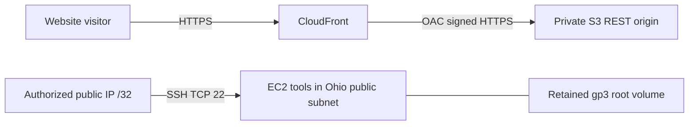

# ADR-001 Use private S3 and CloudFront for the static website and EC2 for tools

**Status:** Proposed

**Date:** October 13, 2026

**Owner:** Josh Escobar, Cloud Architect

**Requested reviewer:** Alyssa Esteves, shared-document owner; review date pending

**Traceability:** [SCRUM-15](https://joshescobarx.atlassian.net/browse/SCRUM-15), [SCRUM-39](https://joshescobarx.atlassian.net/browse/SCRUM-39)

## Context

Week 2 requires a static website available over HTTPS from a private S3 origin, and an Amazon Linux t3.micro tools instance in the existing Ohio public subnet. SSH must be restricted to one authorized public IPv4 /32. The tools instance must be stopped after validation. The existing budget is $5 per month, with an actual-spend alert above $4. [SCRUM-16](https://joshescobarx.atlassian.net/browse/SCRUM-16), [SCRUM-17](https://joshescobarx.atlassian.net/browse/SCRUM-17), [SCRUM-18](https://joshescobarx.atlassian.net/browse/SCRUM-18).

The landing zone uses us-east-2 and us-east-2a. This preserves the existing foundation; being in Ohio does not make every service free. The website must remain available while the tools instance is stopped.

## Decision

1. Store static files in a private S3 bucket in us-east-2, using a regular bucket REST endpoint. Keep Block Public Access enabled and use bucket-owner-enforced ownership and SSE-S3 encryption as proposed defaults. Enable versioning and model retained copies in storage costs.
2. Serve viewers through CloudFront using its default HTTPS domain and certificate. Use Origin Access Control with SigV4 signing set to always. Allow CloudFront's service principal to read objects, scoped to the distribution ARN; this is not a public-read bucket policy. Use a viewer policy that redirects HTTP to HTTPS and verify both viewer and origin protection. [AWS OAC guidance](https://docs.aws.amazon.com/AmazonCloudFront/latest/DeveloperGuide/private-content-restricting-access-to-s3.html).
3. Use CloudFront pay-as-you-go and keep AWS WAF disabled as required by the course. Use basic metrics; additional logging or paid features require an updated estimate.
4. Reserve EC2 for tools and the SSH exercise. Use the established VPC, subnet and tools security group, require IMDSv2, restrict SSH to the authorized /32, and stop the instance after coordinated tests. Proposed cost defaults are Standard CPU credits and an 8 GiB gp3 root volume.
5. Explicitly request an auto-assigned public IPv4 for the instance because subnet auto-assignment is disabled. Avoid a retained Elastic IP. Recheck the public address after restart; do not loosen the authorized source rule to compensate for a changed instance address.
6. Manage subsequent infrastructure changes through reviewed CloudFormation under AGENTS.md. This ADR authorizes no deployment.

S3 and CloudFront are not placed inside the VPC. Website requests do not traverse the EC2 instance. Resource labels are architectural roles; actual names follow the [approved standard](../week1/Design_Standards_Cloud_Architect/01_Cloud_Foundation_and_Naming_Standard.md), including ec2-tools-team07, ebs-tools-team07, cf-site-team07 and oac-site-team07. The S3 suffix must be resolved during implementation rather than treating the example name as available.

## Rejected alternatives

| Option | Benefit | Reason rejected |
| --- | --- | --- |
| Host the website directly on the tools EC2 instance | Familiar web server and one machine | Conflicts with stopping the tools instance after testing; adds web-server patching and certificate operations. Keeping it running also exceeds the current budget in the modeled scenario. |
| Public S3 website endpoint | Simple static website setup | Fails private-origin requirement; S3 website endpoints do not support the chosen OAC pattern. |
| CloudFront flat-rate bundle | Predictable bundle price | Introduces bundled features such as WAF and a different cost basis. It does not match the proposed pay-as-you-go/no-WAF course configuration. Revisit if course scope changes. |

## Rationale and consequences

Managed website delivery separates public availability from the tools VM schedule and avoids maintaining a web server on EC2. OAC restricts anonymous origin access, while deployment roles still need appropriate permissions. This is a static architecture; dynamic server-side behavior requires a later decision.

Uploads do not guarantee an immediate viewer update. Use versioned asset names and deliberate cache invalidation for entry pages. Verify a redeployed change under SCRUM-17. Keep origin requests, viewer traffic and invalidation paths distinct in cost estimates.

Under the proposed lab assumptions, recurring cost is **$0.98/month before account credits**, compared with **$11.91/month at 730 hours**. Those scenarios assume shared CloudFront/transfer allowances remain available. The budget excludes credits; temporary credits do not justify continuous operation. EBS and S3 versions continue to cost money when EC2 stops or a retained bucket outlives a stack. [Cost model and assumptions](../week2/SCRUM-15-costs.md).

Standard CPU mode may throttle sustained workloads. A stopped VM is unavailable for administration until restarted. The single-AZ tools instance has no high-availability commitment. The managed website can remain available independently. Existing Week 1 security exceptions remain recorded separately; this design does not close them.

## Validation and revisit conditions

- SCRUM-17 must prove known-object existence, successful CloudFront HTTPS delivery, anonymous direct-S3 denial, correct OAC/bucket policy, and a redeployed change. A 403 alone is insufficient proof because an absent object can also return 403.
- SCRUM-16/18 must provide actual VM facts, IMDSv2, authorized SSH success, unauthorized/CloudShell denial and the stopped final state. This ADR records no passed deployment tests.
- Revisit if runtime or traffic exceeds the estimate, credits expire, pricing mode changes, paid features are enabled, dynamic hosting is required, or course requirements change.
- Accept ADR-001 only after owner/reviewer agreement and final cost/form reconciliation. Proposed defaults are not evidence of their implementation.
