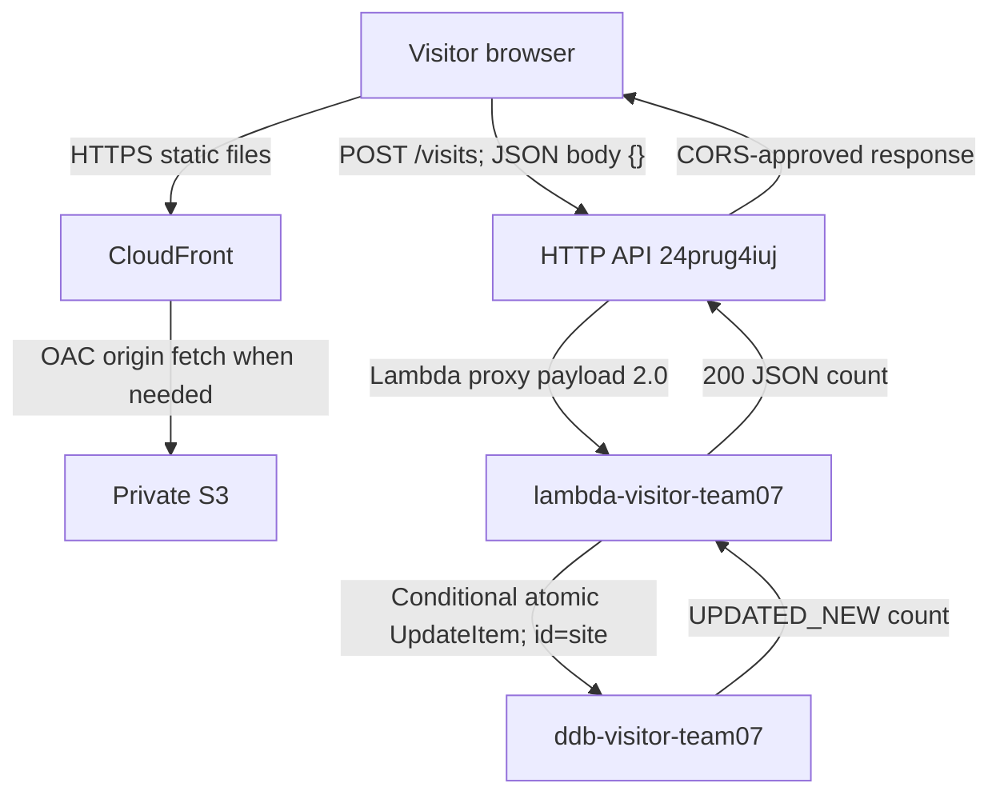

# SCRUM-20: Deployed serverless request flow

Owner: Josh Escobar. Prepared October 20, 2026 for [SCRUM-20](https://joshescobarx.atlassian.net/browse/SCRUM-20) and [SCRUM-46](https://joshescobarx.atlassian.net/browse/SCRUM-46). The architect-owned request-flow section is populated in the [SCRUM-24 working specification](SCRUM-24-application-api-spec.md), owned by Alyssa and reviewed by Josh.

This document reconciles the deployment evidence recorded on October 19 with the implementation. It does not claim a fresh AWS test on October 20. Final specification review, the foreign-origin browser test and end-of-week screenshots remain outstanding.

## Deployed components

| Component | Actual value | Responsibility |
| --- | --- | --- |
| Website | https://d3jg1ev4a532iw.cloudfront.net/ | HTTPS page and static assets |
| CloudFront | cf-site-team07 / E1PBX75YJOS2B9 | Cached static delivery; OAC access to private S3 |
| S3 origin | s3-site-team07-a7f391 | Stores index.html and website assets |
| HTTP API | api-visitor-team07 / 24prug4iuj | POST /visits, exact-origin CORS and Lambda integration |
| Endpoint | https://24prug4iuj.execute-api.us-east-2.amazonaws.com/visits | Direct browser API destination; $default stage with no URL stage prefix |
| Lambda | lambda-visitor-team07 | Validates the request, increments the fixed item and returns JSON |
| Execution role / policy | role-lambda-team07 / policy-visitor-ddb-team07 | Exact-table UpdateItem limited to partition key site; own log writes |
| DynamoDB | ddb-visitor-team07 | String partition key id; item id=site; numeric count; on-demand Standard |
| Data / API stacks | cfn-visitor-data-team07 / cfn-visitor-api-team07 | Separate ownership; API stack references the existing table |
| Workload region | us-east-2 | API Gateway, Lambda and DynamoDB |

## Request and response paths

1. The browser loads the website over HTTPS. CloudFront serves static files from cache or fetches them from private S3 using Origin Access Control. Anonymous S3 index.html access returned 403 during deployment verification.
2. The deployed HTML loads an external counter script and supplies the actual endpoint. Its CSP permits same-origin scripts and connections to the exact API host. The source HTML's empty endpoint is filled by the release builder; it is not the deployed HTML.
3. The script sends one POST per page load directly to the execute-api endpoint with Content-Type application/json, body `{}` and credentials omitted. CloudFront does not proxy API requests in this design.
4. The browser performs an OPTIONS preflight unless it can reuse a cached preflight. API Gateway handles OPTIONS without invoking the counter Lambda or writing to DynamoDB. It allows exactly `https://d3jg1ev4a532iw.cloudfront.net` (no trailing slash), POST/OPTIONS and content-type; credentials are disabled and max age is 300 seconds.
5. API Gateway matches POST /visits on the $default stage and invokes Lambda with proxy payload 2.0. The function's invocation permission is scoped to this API, account, stage, method and route.
6. Lambda validates method/path, Origin and an empty JSON object. Using its execution role, it performs one conditional DynamoDB UpdateItem on `{"id":"site"}`: `SET #count = #count + :one`, with `:one=1` and ReturnValues=UPDATED_NEW. The condition requires an existing item and a numeric, nonnegative count below JavaScript's safe-integer limit. There is no separate read-then-write, seed, reset or caller-selected item.
7. DynamoDB returns the new count. Lambda checks the integer and returns HTTP 200 with `{"count":N}`, Content-Type application/json and Cache-Control no-store. API Gateway applies CORS; the browser validates and displays the number using textContent.

The count includes reloads and test traffic; it is not a unique-visitor metric. Atomic increments prevent concurrent lost updates, but do not guarantee exactly-once delivery. The browser script and configured SDK do not automatically retry. A response can be lost after a successful write; a later reload counts again.

## Failures and trust boundaries

| Situation | Behavior |
| --- | --- |
| Invalid content/body | Lambda 400 / invalid_request before writing |
| Missing/foreign Origin | Lambda 403 / origin_not_allowed before writing; browser CORS may hide the response |
| Foreign preflight | Recorded HTTP test: 204 without matching allow-origin; independent browser rejection is pending |
| Unmatched public route/method | API Gateway 404; defensive direct-Lambda method guard returns 405 |
| Failed condition, datastore/access error or invalid returned count | Lambda 503 / counter_unavailable; no reset or automatic retry |
| Platform throttling/failure | Gateway-dependent 429/5xx; site displays Temporarily unavailable on request/response failure |

The API is public (AuthorizationType NONE). CORS controls browser access and is not authentication; non-browser clients can spoof Origin. Lambda's role permits UpdateItem only on the exact table and site key, plus its own log-stream writes. The browser has no database credentials; the deployed function environment contains only TABLE_NAME and ALLOWED_ORIGIN. API access logs omit bodies, headers and client IPs. Both application log groups retain logs for seven days.

## Evidence and handoff

The API stack reached CREATE_COMPLETE on October 19 at 20:04:51.881 CDT. Recorded HTTP tests returned counts 1–4, including three concurrent requests; a strong read confirmed 4. The subsequent real browser page displayed 5. These are historical observations; the public count may now differ. Initial zero evidence predates these tests. Never reset the counter for screenshots.

| Evidence | Supports |
| --- | --- |
| [Datastore handoff](https://github.com/greycarpet/Team7/blob/54825ef4c11b5dc8133f71feff33a001e8b8de7c/docs/week3/SCRUM-21-deployment-handoff.md) | Table, schema, settings and initial zero |
| [API deployment handoff](https://github.com/greycarpet/Team7/blob/14e6c7104e15001b975de4a5cef7543fa82dbc5c/docs/week3/SCRUM-22-deployment-handoff.md) | Endpoint, deployed configuration, website release and remaining browser procedure |
| [Deployment evidence](https://github.com/greycarpet/Team7/blob/14e6c7104e15001b975de4a5cef7543fa82dbc5c/docs/week3/evidence/SCRUM-22/20261019_Team7_aws_w3-api-deployment.json) | Stack results, permissions, logs and strong reads |
| [HTTP test evidence](https://github.com/greycarpet/Team7/blob/14e6c7104e15001b975de4a5cef7543fa82dbc5c/docs/week3/evidence/SCRUM-22/20261019_Team7_aws_w3-api-tests.json) | Success, concurrent increments, preflight and negative requests |
| [Browser verification](https://github.com/greycarpet/Team7/blob/14e6c7104e15001b975de4a5cef7543fa82dbc5c/docs/week3/evidence/SCRUM-22/20261019_Team7_browser_w3-counter-verification.json) | Allowed-origin browser count and explicitly pending foreign-origin check |

The cloud browser rejected the local data: test page before navigation. This tooling limitation is not a passed CORS test. Josh's manual procedure is in the API deployment handoff. Capture genuine screenshots at the end of Week 3, using the actual capture date and current state, per Josh's instruction. That timing supersedes earlier instructions in the datastore handoff.

SCRUM-46's request-flow documentation is ready. SCRUM-20 remains subject to review of the architect-owned specification section and course evidence. Alyssa retains SCRUM-24 ownership; this working draft is not a submitted course form or final PDF.
