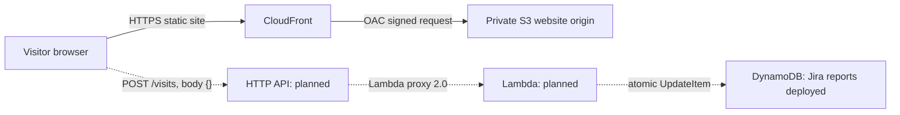

# SCRUM-24: Application API specification

**Status:** Draft; DynamoDB deployment is reported in Jira, while Lambda/API deployment and live testing remain unverified.  
**Branch:** `feature/SCRUM-24-application-api-spec`  
**Ticket:** [SCRUM-24](https://joshescobarx.atlassian.net/browse/SCRUM-24) (ticket page was not accessible during this review).  
**Last reviewed:** October 19, 2026.

## Status summary

This table separates Jira-reported deployed data storage from the API implementation details in Josh's source branch. The source and template describe the planned API behavior; they do not prove that Lambda or API Gateway is deployed or live.

| Work item | Current status | Evidence boundary |
| --- | --- | --- |
| SCRUM-21 DynamoDB data store | Jira reports deployed in `us-east-2` as `ddb-visitor-team07`, in stack `cfn-visitor-data-team07`. | Jira-reported deployed resource. This is separate from Josh's proposed API stack. |
| DynamoDB key and seed data | Jira reports partition key `id` (String) and initial item `{ "id": "site", "count": 0 }`. | Jira-reported table configuration and seed item. |
| SCRUM-47 and SCRUM-48 | Jira reports both tickets Done. | Ticket status reported by the user from Jira; not independently checked in Jira. |
| SCRUM-22 Lambda/API implementation | Source is present on `origin/feature/SCRUM-22-visitor-api` at commit `e7e283d` and is associated with draft PR #9. | Source describes a planned HTTP API and Lambda. The deployment plan and validation record say not deployed; no live route or endpoint URL is verified. |
| SCRUM-24 API integration | Source proposes `POST /visits`, `$default` stage, and a visitor-counter website integration. | Contract and website behavior can be documented from source; deployed endpoint and live behavior remain unverified. |

## Purpose and scope

This document is the working specification record for the application API. It separates the Jira-reported deployed DynamoDB resource from implementation details in Josh's source branch. Those source details document the intended behavior; they are not live deployment results.

The source defines `POST /visits` and its request/response behavior. The actual API endpoint URL is not in the source and must be recorded from the deployed stack output after deployment. No endpoint URL is guessed here.

## Verified architecture today

The current website is static content in a private S3 bucket, delivered to visitors over HTTPS by CloudFront. The deployed website and its recorded verification are documented in [the SCRUM-17 handoff](../week2/SCRUM-17-handoff.md) and [its evidence index](../week2/evidence/SCRUM-17/README.md).

| Component | Verified information | What it means for this API |
| --- | --- | --- |
| CloudFront | The deployed distribution is `cf-site-team07` (`E1PBX75YJOS2B9`); the HTTPS site is `https://d3jg1ev4a532iw.cloudfront.net/`. CloudFront serves the static site from a private S3 REST origin using OAC. | The website origin is known. It is not evidence that an API origin or CloudFront API behavior exists. |
| API Gateway | Josh's source defines an HTTP API named `api-visitor-team07`, route `POST /visits`, and `$default` stage with auto-deploy. | Planned in source; not verified live. The deployed API ID and endpoint URL remain unknown. |
| Lambda | Josh's source defines `lambda-visitor-team07`, Python 3.13 on arm64, 256 MB memory, five-second timeout, and environment variables for table name and allowed origin. | Planned in source; not verified live. The function has not been shown to run against the live API or table. |
| DynamoDB | Jira reports table `ddb-visitor-team07` deployed in `us-east-2` by stack `cfn-visitor-data-team07`; partition key `id` (String); initial item `id=site`, `count=0`. | Jira-reported deployed table. Josh's API template references this existing table by name and does not create or reconfigure it. |

The API and Lambda names above appear in Josh's proposed CloudFormation source; their presence there is not proof those resources have been deployed. The DynamoDB name and configuration are separately reported deployed in Jira.

Josh's website source adds a visitor-count display and external JavaScript. The unrendered source leaves its API URL blank and sets Content Security Policy `connect-src 'none'`. A local release builder is designed to insert a verified endpoint and allow that exact API origin. This is planned website integration; the updated files have not been proven live in the deployed CloudFront site.

## Proposed API contract — deployment details pending

The following contract is documented from Josh's source code and handoff on `origin/feature/SCRUM-22-visitor-api` (commit `e7e283d`). It describes planned behavior, not live API test results. The route is not verified live, and the API base URL must be recorded only after deployment from the `VisitEndpoint` stack output.

| Contract item | Decision |
| --- | --- |
| API type, route, stage | HTTP API; `POST /visits`; `$default` stage with auto-deploy. |
| Base URL | TBD — obtain the actual `VisitEndpoint` CloudFormation output after deployment; no endpoint URL is invented here. |
| Request | `Content-Type: application/json`; body must be the empty JSON object `{}`. The handler rejects any caller-supplied key or count. |
| Successful response | HTTP 200; JSON body `{"count":number}` containing the incremented positive integer. Response has `Cache-Control: no-store`. |
| Error responses | HTTP 400 `{"error":"invalid_request"}` for invalid content/body; HTTP 403 `{"error":"origin_not_allowed"}` for missing or non-allowed Origin; HTTP 503 `{"error":"counter_unavailable"}` for a missing/invalid counter or datastore/access failure. |
| Other route/method behavior | API Gateway handles unmatched public routes (404) and OPTIONS preflight. The Lambda has defensive guards returning 404 for a wrong path and 405 for a wrong method if invoked directly. Gateway throttling/platform responses may be 429 or 5xx. |
| Authentication | No API authentication is configured in source (`AuthorizationType: NONE`); it is a public demo endpoint. CORS and Origin checking are not authentication. |
| CORS | Allow only `https://d3jg1ev4a532iw.cloudfront.net`; methods POST and OPTIONS; header `content-type`; credentials disabled; preflight max age 300 seconds. |
| DynamoDB table and item | `ddb-visitor-team07`; fixed key `{ "id": "site" }`, matching Jira-reported String partition key and seed item. |
| Update behavior | Atomic `UpdateItem`: `SET #count = #count + :one`, returning `UPDATED_NEW`. A condition requires the item to exist and count to be numeric, non-negative, and below JavaScript's maximum safe integer. Lambda never seeds or resets the item. |
| Lambda permissions | Planned role `role-lambda-team07` can call `dynamodb:UpdateItem` on only the named table, limited by `dynamodb:LeadingKeys` to `site`, and can write to its own Lambda log group. It has no GetItem, PutItem, or DeleteItem permission in this policy. |
| Throttling | `$default` stage is configured for 2 requests per second with burst limit 5; this is best-effort throttling, not a hard spending cap. |
| Retry behavior | Browser and SDK do not automatically retry. A response may be lost after an increment succeeded, so a later page reload counts as another visit; exactly-once counting is not guaranteed. |
| Logging | Planned API access logs include request ID, route, status, integration status, and response length. Lambda logs an error category and request ID. Both log groups are configured for seven-day retention. |

## Request flow — partly reported deployed, API path still proposed

The Week 2 CloudFront-to-private-S3 website path is verified in the repository. Jira separately reports the DynamoDB table deployed. The following API and website integration flow is described by Josh's source code and is not verified as live deployment behavior.

The dotted links are implementation plans from Josh's source, not verified live connections. The browser is planned to call the API endpoint directly; no CloudFront API behavior is defined. The website script sends one POST per page load, displays the returned number using `textContent`, and shows “Temporarily unavailable” on failure. The endpoint remains blank in source until a release build receives the real deployed URL; the builder is designed to set CSP `connect-src` to that exact API origin.

## Security and deployment notes

- Keep the static S3 origin private and continue using CloudFront OAC, as verified for SCRUM-17.
- Do not place secrets in browser code, site files, Lambda environment variables committed to Git, or this specification.
- Josh's source plans a narrowly scoped Lambda policy: `UpdateItem` for the exact visitor table and partition key `site`, plus writes to its own logs. This is template intent until deployment and role inspection verify the effective policy.
- Josh's source plans direct browser calls to the API endpoint, with exact-origin CORS and a generated CSP connection rule. Browser CORS/CSP behavior still needs a real browser test after deployment and site publication.
- The API deployment plan names a proposed stack `cfn-visitor-api-team07` and specifies the table as an existing resource; it does not authorize deployment or modify the DynamoDB stack/table.
- All AWS changes remain subject to the repository's read-only-by-default policy. This document authorizes no deployment or resource change.

## Work still waiting on Josh

- [ ] Deploy only after the required explicit AWS authorization and the deployment plan's resource/security/cost review; no deployment is claimed here.
- [ ] Record the actual `VisitEndpoint` output and verify the deployed HTTP API route and `$default` stage.
- [ ] Run live success/error tests and verify the atomic counter change against the existing `id=site` row without resetting it.
- [ ] Inspect the deployed Lambda role and confirm its effective least-privilege permissions.
- [ ] Test CORS preflight and foreign/missing Origin behavior in a real browser; CORS settings in source are not proof of browser behavior.
- [ ] Build and publish the website with the real endpoint, then verify CSP, browser request, displayed counter, and live CloudFront release.
- [ ] Add deployment/test evidence and final screenshots after actual verification.

## Evidence reviewed

- [Week 2 SCRUM-17 handoff](../week2/SCRUM-17-handoff.md): deployed CloudFront/S3 values and live-site verification; at the time of that Week 2 handoff, no API or visitor-counter integration was implemented.
- [Week 2 SCRUM-17 deployment plan](../week2/SCRUM-17-deployment-plan.md): origin protection and CSP notes for future JavaScript/API work.
- [ADR-001](../adr/ADR-001.md): accepted static-site architecture and limits of the existing decision.
- [Team7 naming standard](../week1/Design_Standards_Cloud_Architect/01_Cloud_Foundation_and_Naming_Standard.md): resource naming examples only.
- Josh's source branch `origin/feature/SCRUM-22-visitor-api`, commit `e7e283d`: `application/lambda/visitor_counter.py`, `infrastructure/cloudformation/week3/visitor-api.yaml`, `site/assets/visitor-counter-v1.js`, `site/index.html`, and `scripts/build_visitor_site.py` define the proposed API, counter behavior, CORS/IAM/throttling plan, and website integration.
- Josh's branch records: `docs/week3/SCRUM-22-how-to.md` describes the request/response contract; `docs/week3/SCRUM-22-deployment-plan.md` says the implementation is prepared but not deployed; `docs/week3/evidence/SCRUM-22/local-validation.json` records offline checks; `docs/week3/evidence/SCRUM-22/aws-validation.json` records preflight checks, not live API testing.
- Jira information supplied for this update: SCRUM-21 reports the DynamoDB deployment and table configuration; SCRUM-47 and SCRUM-48 are reported Done; SCRUM-22 reports Josh's Lambda/API work in draft PR #9; SCRUM-24 proposes `POST /visits` and requires post-deployment endpoint verification. These Jira facts were supplied by the user and were not independently checked in Jira during this review.
- Jira [SCRUM-24](https://joshescobarx.atlassian.net/browse/SCRUM-24): linked for traceability; ticket page was inaccessible during this review.
- Josh's deployment plan and validation records explicitly state that the API/Lambda were not deployed and that no live increment was performed at the time of those records.

